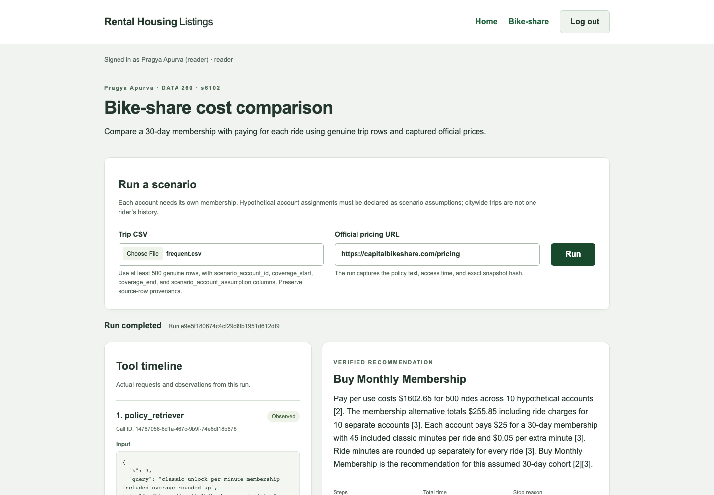
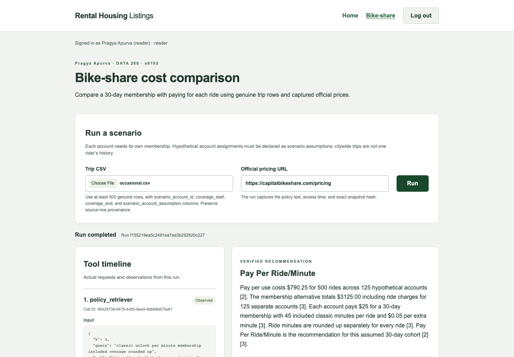

# DATA 260 HW7 — Part 4 checkpoint

Pragya Apurva · SID4 6102 · seed 6102 · Capital Bikeshare (Washington, DC).

Both genuine browser acceptance runs used clean application commit `22c673db820a56ca4fb12ec1f27a175db6825a6f` on `codex/hw7-part4`. The dependency commit is `fe645bb1ab2ae534828017a34f22aba5b3157fb4`; the implementation commits are `f8ed1e2a8ce603ec1a9f5b43a776976e099795e5` and the tested application commit above. Parts 1–3 and their frozen experiments remain preserved. Parts 5–6, the final PDF, submission self-check and `hw7` tag are deferred.

## Framework and tool boundaries

The shared React/FastAPI application adds one authenticated bike-share screen. LangGraph 1.0.8 `create_react_agent` v2 and `ToolNode` execute the reasoning/action loop through the existing model adapter. Parts 2–3 remain hand-written. [Operations guide](../../docs/HW7_PART4.md), [agent](../../src/bikeshare/agent.py), [three tools and exact JSON schemas](../../src/bikeshare/tools.py), [cost calculation](../../src/bikeshare/costs.py), and [pinned dependencies](../../requirements-hw07-part4.lock.txt) supply the reproducible implementation.

`csv_sql` runs one bounded SQLite SELECT over the uploaded private trip table. Query-only mode, SQLite's authorizer, an approved-function list, and row/instruction/time ceilings enforce that boundary. `policy_retriever` returns exact official-source passages from a run-local capture. `calculator` enforces the assignment arithmetic whitelist and interprets a bounded syntax tree without eval. All return the success/data/error/source/ts envelope.

The framework selects native tool calls; a trusted phase hint uses observed policy/SQL facts to guide the next call and compares both observed calculator totals before the final answer. The answer follows a five-sentence fact template. Independent cost and claim checks accept or reject the original answer without rewriting it. This is a guided framework demonstration, not an unassisted model-reasoning benchmark. No hidden chain-of-thought is displayed.

## Genuine trips and scenario assumptions

The [official system-data page](https://capitalbikeshare.com/system-data) links the [January 2024 trip archive](https://s3.amazonaws.com/capitalbikeshare-data/202401-capitalbikeshare-tripdata.zip). Its CSV contains 238,834 genuine rows. Each frozen scenario retains all thirteen original fields and original source-row provenance, then appends hypothetical account/window declarations. [Source record](raw/part4/sources/trip-source.json), [frozen selection and hashes](cases/bikeshare/manifest.json), [frequent input](cases/bikeshare/frequent.csv), and [occasional input](cases/bikeshare/occasional.csv) preserve the exact basis. `scripts/hw07/bike_cases.py --source <official CSV> --verify` reproduces both byte-identical selections.

The common window is January 1, 2024 inclusive through January 31 exclusive in Washington local time. Ten hypothetical frequent accounts take fifty rides each; 125 hypothetical occasional accounts take four each. Original durations and dates are unchanged, and no assigned account has overlapping rides or a turnaround shorter than two minutes. These groups are scenario assumptions, not observed rider histories; one membership never covers unrelated citywide riders. Current captured prices are applied counterfactually to these historical trip durations.

## Accepted decisions and numeric explanations

| Scenario | Rows / accounts | Pay per use | Membership fees + residual = total | Exact decision |
| --- | --- | --- | --- | --- |
| frequent | 500 / 10 | $1602.65 | $250.00 + $5.85 = $255.85 | Buy Monthly Membership |
| occasional | 500 / 125 | $790.25 | $3125.00 + $0.00 = $3125.00 | Pay Per Ride/Minute |

**Frequent use.** The 500 classic rides contain 7,351 individually rounded minutes, so casual cost is 500 × $1 + 7,351 × $0.15 = $1,602.65. Ten separate $25 memberships cost $250, and eleven rides exceed their own 45-minute allowance by 117 billed minutes, adding $5.85; total membership cost is $255.85 and savings are $1,346.80. **Buy Monthly Membership** follows the freshly captured [single-trip](https://capitalbikeshare.com/pricing/single-trip) and [30-day membership](https://help.capitalbikeshare.com/hc/en-us/articles/360039401111-30-Day-Membership) rules. Each assumed account has fifty rides and 671–837 billed minutes, versus the repeated-sample-mix break-even of eight rides or 117.62 billed minutes. The actual framework run finished after **11 steps**, with stop reason **success** and 198.87 seconds elapsed.

**Occasional use.** These 500 classic rides contain 1,935 individually rounded minutes, giving 500 × $1 + 1,935 × $0.15 = $790.25 in casual charges. Purchasing a separate $25 membership for each of 125 assumed accounts costs $3,125 with no overage charges, so **Pay Per Ride/Minute** saves $2,334.75 under the freshly captured [single-trip](https://capitalbikeshare.com/pricing/single-trip) and [membership](https://help.capitalbikeshare.com/hc/en-us/articles/360039401111-30-Day-Membership) rules. Each account takes four rides and has 11–19 billed minutes, below the sample-mix break-even of sixteen rides or 61.92 billed minutes. The actual framework run finished after **11 steps**, with stop reason **success** and 230.26 seconds elapsed.

| Final run | Steps | Model requests | Actual tools | Reported tokens | Agent latency ms | Stop reason |
| --- | --- | --- | --- | --- | --- | --- |
| frequent | 11 | 5 | 6 | 14969 | 198865.38 | success |
| occasional | 11 | 5 | 6 | 15099 | 230260.84 | success |

Steps count actual framework stream updates; model requests and individual tool calls have separate denominators. Latency starts after CSV parsing and URL validation, then covers policy capture, framework/model/tool execution and independent verification inside the agent. It excludes upload validation, browser login and screenshot capture. Both runs used local `qwen3:8b`, temperature 0, seed 6102, context 32,768 and output cap 512. Hard limits were eight model requests, sixteen proposed/actual tools, 48,000 conservatively charged tokens and 600 seconds per worker. [Model digest/runtime profile](raw/part4/model-profile.json) and [computed metrics](raw/part4/metrics.json) record exact configuration.

## Genuine UI demonstrations and retained evidence

[Frequent full UI](screenshots/part4/frequent-full.png) and [occasional full UI](screenshots/part4/occasional-full.png) show the actual tool timeline/observations, decision, costs, metrics, weekly table, assumptions, break-even and captured sources. The student's name is visible at the top. Focused overview, weekly, assumptions and citations captures accompany each full capture. Chromium submitted once per scenario using a real login and checked all required panels and responsive widths.

Each final directory ([frequent](raw/part4/final/frequent/run.json), [occasional](raw/part4/final/occasional/run.json)) contains the exact input, machine-readable summary/weekly/accounts, full native-ID model/tool trace, unchanged model answer/result, browser assertions and captured pricing HTML/text. The `policies/*.json` records original/final URL, access UTC, exact text SHA-256 and separate HTML SHA-256; citations match those byte hashes. Source [1] is the main pricing page, [2] single-trip, and [3] the official 30-day help page, which states rounding. Fresh frequent captures occurred at 08:06:20 UTC and occasional captures at 08:10:10–12 UTC on October 22, 2026. Snapshots, rather than a later live page, define each saved result.

An [independent standard-library audit](raw/part4/audit.json) checks all 13,000 original cell values, selection/account replay, exact source and policy bytes, per-ride cents, every account/week, break-even, cited claims, native IDs/tool-role pairing and trace-derived metrics. It imports neither the application cost module nor its verifier. Audit-script drafts are engineering artifacts; only the completed audit is required evidence here.

## Checks, failures and limits

The final full web-compatible regression passed **1255 tests**, with **25 existing opt-in skips**. The focused Part 4 suite passed **123 tests**. Tests include controlled responses and real transactional database fixtures; they are separate from real local-model measurements. Ruff, formatting, Vite build and both genuine implementation pre-commit hooks passed. [Live HTTP regression](raw/part4/live-http.json) passed twenty checks; [actual-run ownership](raw/part4/live-owner-isolation.json) passed eight more (owner 200, other account 404, missing bearer 401). A [separate controlled browser recovery test](raw/part4/controlled-browser-recovery.json) proves transient polling recovery, navigation resumption and account isolation, without making model measurements. Earlier dependency files/environments and frozen Parts 1–3 evidence remain unchanged; the previous web environment still imports the new shared app.

All eleven adaptive [unscored pilots](raw/part4/pilots/index.json) are retained separately from the two final acceptance demonstrations, including premature/incomplete tool use, unavailable usage after a timeout, incorrect arithmetic and a correct-total/wrong-decision answer. Settings and phase guidance changed during those pilots, so they are not a reliability denominator. In particular, p10's $790.25 versus $3,125 totals accompanied a wrong membership recommendation; the verifier returned human_review. The correction used both actual calculator observations to guide the cheaper decision; p11 and both committed final UI runs passed. No failed answer was converted into an accepted result.

The calculator exposes binary floating-point values (the frequent PAYG observation is 1602.6499999999999); independent currency costs use Decimal/per-ride cents and the saved final amount is $1,602.65. The independent audit retains this 1e-13 residue and checks arithmetic with an explicit tolerance, rather than claiming bit-for-bit decimal equality. Costs are pre-tax base transportation amounts: location-dependent tax, parking and penalties are not observed in the CSV and are excluded. Both acceptance files contain classic bikes; separate deterministic tests cover ebike charges. The mixed-duration break-even repeats the sample mix and is approximate, not a guarantee for every ride ordering. Weekly tables allocate every account's membership fee to the coverage-start week and show residual charges separately. The constrained explanation verifier can reject otherwise valid paraphrases; these two guided demonstrations do not establish general model reliability. The compatible 1.x framework API emits a deprecation warning, documented in the operations guide. The UI keeps a run handle within the signed-in session; a full reload clears it, and an ambiguous lost submission response is not automatically resubmitted.
