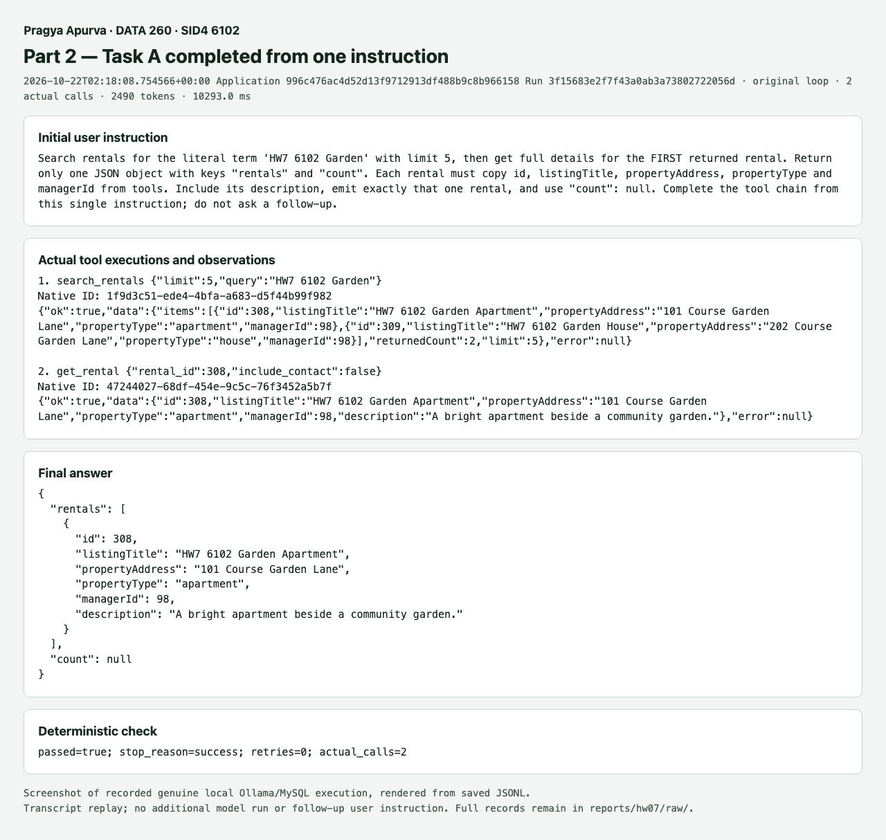
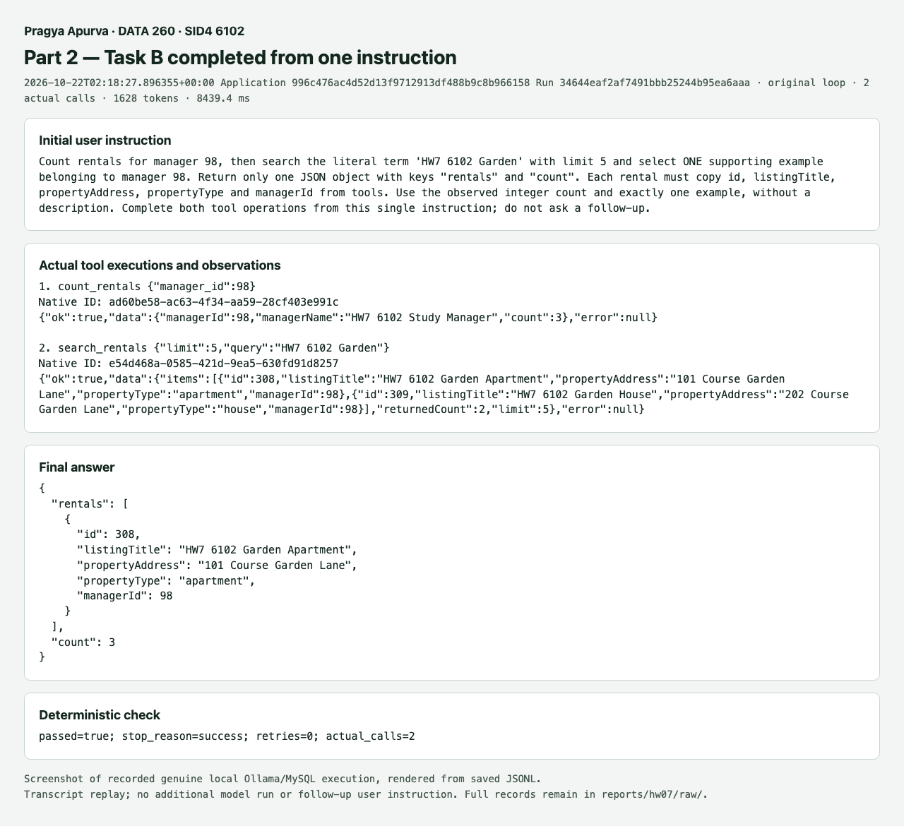
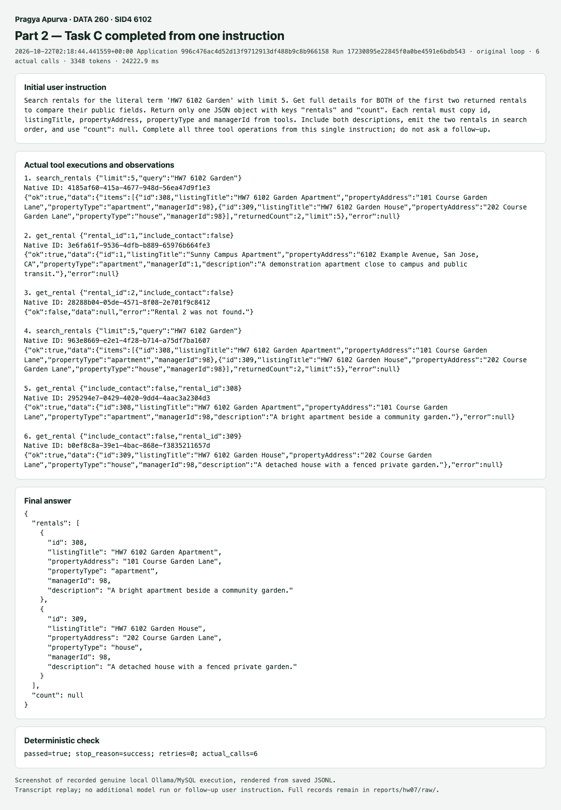
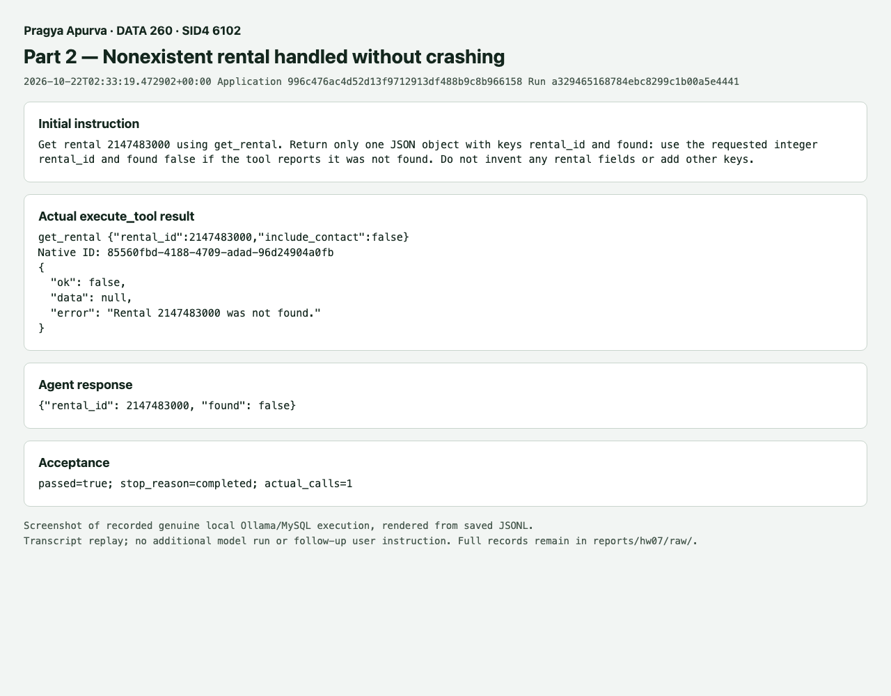
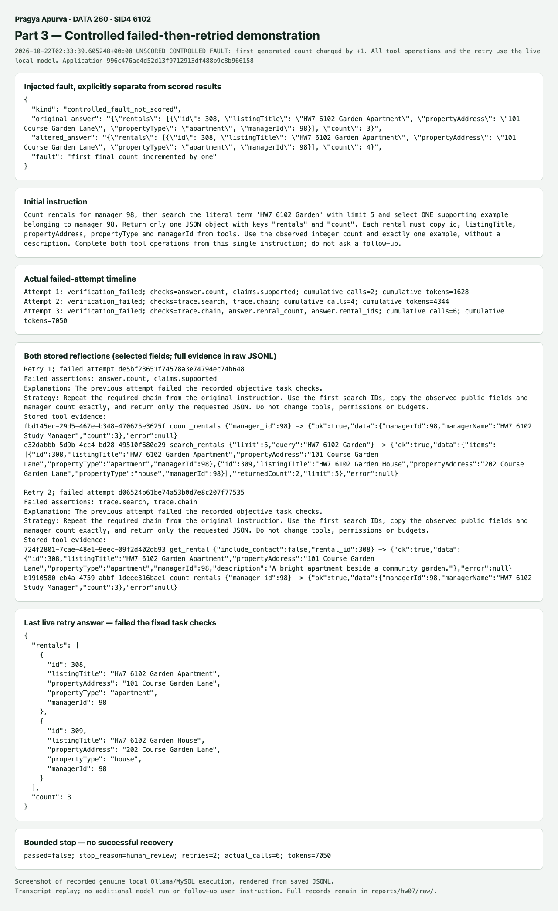

# Parts 2 and 3 checkpoint — hand-written rental agent

Pragya Apurva · DATA 260 · SID4 **6102** · PORT_BASE **8702** · PREFIX **s6102** · SEED **6102** · VERIFY_SEED **266102** · DOMAIN_ID **6**, Rental Housing Listings.

Branch: `codex/hw7-parts2-3`. Tested application: `996c476ac4d52d13f9712913df488b9c8b966158`. The same semester application and HW1 model adapter/HW5 rental tools are extended. Part 1 evidence is preserved. Parts 4–6, final PDF, final tagged smoke check and submission tag remain for later sessions.

## Fixed inputs and provenance

Hardware: Apple M4, 24 GiB unified memory. Local model: `qwen2.5:7b`, digest `845dbda0ea48ed749caafd9e6037047aa19acfcfd82e704d7ca97d631a0b697e`. Temperature 0, seed 6102, context 16,384, output cap 512, request timeout 90 seconds. Eight model responses and eight actual tool executions are allowed per attempt. Reflexion has at most two retries; one ledger allows 24 actual tools and 24,000 tokens across the entire task. The original loop gets one attempt and the same 24,000-token ceiling.

The controlled MySQL fixture has manager 98 and rentals 308/309/310. `HW7 6102 Garden` returns 308 then 309; the manager owns three rentals. [Frozen tasks](cases/agent_tasks.json) contain the exact prompts and expected public facts. [Experiment freeze](cases/experiment.json) records source/input/schema/tokenizer/dependency hashes, scoring rules, settings and the alternating 21-pair schedule. Freeze time: `2026-10-22T02:17:27.198692+00:00`. The scored manifest is [saved here](raw/parts2-3/manifest.json).

Four exploratory pilots preceded the freeze, including a final pilot after review fixes. Failures included guessed IDs and an incomplete answer; an 8,192 context guard stopped Task C before its final answer. Those real outputs remain in RUN_LOG. The 16,384 context pilots completed all tasks. No exploratory attempt is included in the scored denominator.

## Part 2 implementation and genuine outputs

[`run_agent`](../../src/tool_agent/loop.py) uses `complete(messages, tools=schemas)`, retains the native assistant object and IDs (serializing malformed arguments as nonexecuted placeholders for a repair), executes only allowlisted validated operations, and appends each result with its matching native ID:

```python
messages.append(raw)
logged_messages.append({**logged_assistant, "tool_calls": _log_value(transport_calls)})
# Validation/execution occurs before this matching result message.
tool_message = {
    "role": "tool",
    "tool_call_id": call["id"],
    "name": call["name"],
    "content": output,
}
messages.append(tool_message)
logged_messages.append(tool_message)
```

These source excerpts omit the surrounding bounds and error checks; the linked source contains the complete implementation. Unknown tools, malformed arguments and schema failures receive a specific sanitized error and one correction opportunity. A second bad correction stops. Repairs consume the same turn/token allowances. Original proposals, repairs and actual executor invocations have separate records. IDs returned by the adapter are carried unchanged through assistant/tool messages; when Ollama omits an ID, the integration supplies a UUID matching identifier.

A requires search then first detail; B requires manager count then a supporting search example; C requires search then both details. All calls below followed one initial user instruction. These are screenshots of recorded genuine Ollama/MySQL transcripts, rendered from raw JSONL; they are not additional model executions. Native IDs, actual results, final answers and the name are visible.







Missing-ID recovery uses the existing `execute_tool` error envelope (`ok: false`, useful `error`) and returns that observation to the model. The final typed result identifies the requested ID with `found: false`, without adding rental fields or crashing.



| Original-loop measure | Result |
| --- | --- |
| Complete tasks | 21/21 |
| First-pass valid proposals | 70 / 70 (100.0%) |
| Valid after the single repair opportunity | 70 / 70 (100.0%) |
| Tool-operation repairs | 0 |

| Fixed task | Original successes | Reflexion successes | Actual calls per case (original / Reflexion) |
| --- | --- | --- | --- |
| A | 7/7 | 7/7 | 2 / 2 |
| B | 7/7 | 7/7 | 2 / 2 |
| C | 7/7 | 7/7 | 6 / 6 |

| Failure category (overlapping case counts) | Original / 21 | Reflexion / 21 |
| --- | --- | --- |
| malformed arguments | 0 | 0 |
| unknown tool | 0 | 0 |
| text when a tool was required | 0 | 0 |
| lost multi-step chain | 0 | 0 |

The denominator is original operation proposals, including rejected proposals. Corrections update the same proposal entry. An attempt that emits no call still counts in task success. Labels can overlap. A syntactically valid call can use an unhelpful ID; chain/fact verification separately determines task success. [Per-case reliability CSV](raw/part2/reliability.csv), [proposals](raw/part2/proposals.jsonl), [complete traces](raw/part2/traces.jsonl), and [attempts](raw/part2/attempts.jsonl) retain every scored run.

The scored Task C runs each made six actual calls, including initial lookups before completing the qualifying search-to-detail chain. There were 7 ordinary not-found executor results in the original mode and 7 in Reflexion. These are retained in the actual-call cost totals. They do not count as malformed argument/schema failures: the calls were well formed, and the final verified results were supported.

The [genuine pre-freeze repair example](raw/part2/unscored-repair/attempt.json) shows Task B rejecting an extra argument and correcting that same operation once: 2/3 first-pass proposals became 3/3 valid after repair. This unscored pilot used an earlier prompt/context configuration and dirty source; it is excluded from every scored denominator. Its [trace](raw/part2/unscored-repair/traces.jsonl) preserves the actual validation error, correction and real executor result.

## Part 3 verifier and bounded Reflexion

[`verify_task`](../../src/tool_agent/verification.py) checks the actual successful search/count/detail sequence and the final JSON facts. A/C must use the first frozen search IDs and their full public details; B must give count 3 and one matching manager example. Premature text and incomplete chains fail. Factual support is checked independently of chain completion, so one wrong field does not turn all correctly sourced fields into unsupported claims. JSON structure is fixed; natural-language wording is not compared. These actual verifier helpers require a later model response for details and separately check each field against frozen facts and tool support:

```python
def _later_response(detail: dict, search: dict) -> bool:
    proposed = detail.get("model_response_index")
    observed = search.get("model_response_index")
    return type(proposed) is int and type(observed) is int and proposed > observed > 0

def _claim_reason(value: Any, field: str, fixture: dict | None, sources: list[dict]) -> str | None:
    if fixture is None or field not in fixture or not _same(value, fixture[field]):
        return "fixture_mismatch"
    if not any(field in source and _same(value, source[field]) for source in sources):
        return "missing_tool_support"
    return None
```

[`run_reflexion`](../../src/tool_agent/reflexion.py) starts each retry with the original instruction and a short untrusted diagnostic from this user/run. No stored reflection is read into another run or global memory. The same `Budget` object spans all attempts:

```python
for retry_index in range(max_retries + 1):
    if budget.tools >= budget.max_tools:
        return finish("budget_exhausted")
    captured = _AttemptLog(logger.stream)
    result = run_agent(
        user_input,
        task=task,
        budget=budget,
        reflection=reflection,
        context={
            "user_id": user_id,
            "parent_run_id": root_id,
            "task_id": task["id"],
            "retry_index": retry_index,
        },
        log_stream=captured,
        **options,
    )
```

Before each model request, a conservative serialized-byte allowance plus a pinned-tokenizer estimate reserves prompt/output space. Reported usage is charged afterward. Unknown usage is unavailable and conservatively charged, never zero. Tool allowance is claimed before execution. All final study rows use `success`, `budget_exhausted` or `human_review`, with internal reasons retained.

| Metric | Original loop | Reflexion loop |
| --- | --- | --- |
| Task success | 21/21 | 21/21 |
| Unsupported final claims, independently audited | 0 | 0 |
| Cases entering a Reflexion retry | 0/21 (0.0%) | 0/21 (0.0%) |
| Actual tool calls, total | 70 | 70 |
| Actual tool calls, mean | 3.3 | 3.3 |
| Reported input tokens, total | 48076 | 48076 |
| Reported output tokens, total | 4186 | 4186 |
| Model tokens, total | 52262 | 52262 |
| Model tokens, mean | 2,488.7 | 2,488.7 |
| End-to-end latency, mean ms | 20,888.5 | 20,990.7 |
| Verifier false rejections, cases | 0 | 0 |

Both modes passed all 21 scored cases without a Reflexion retry. This study shows no observed success improvement from Reflexion; the repeated fixed tasks did not exercise its retry path. The separate controlled fault below demonstrates that path only.

[Comparison CSV](raw/part3/comparison.csv) includes both modes, all repetitions and source commits. [Derived metrics](raw/parts2-3/metrics.json) are computed from the full raw attempts/proposals. Latency includes client/tokenizer preparation, generation, tool execution, checking and any reflection/retry; it excludes later screenshot/report generation. Token totals include all input/output responses, repairs and retries. Deterministic reflection generation makes no model call; its context is charged on the next request.

[Independent claim/trace audit](raw/parts2-3/audit.json) reviews all final answers and every attempt terminal against frozen facts and actual observations, checking for any rejected answer that was actually correct. All scored attempts passed, so there were no rejected scored answers to examine. It records verifier false rejections and unsupported final claims separately from the verifier's own output. No false rejection was observed in this study. This is an observed count, not proof that the verifier cannot reject a valid future answer.

### Failed-then-retried example, separately labeled

The scored study is retained unchanged. A separate **unscored controlled fault** changed only B's first final count from its real generated value by +1, after real generation. The resulting failed assertion was `answer.count, claims.supported`. The stored reflection links the failed answer to actual count/search observations and proposes copying the observed count. Both retries used the unmodified local model. The first corrected the count but omitted the required search. The second searched before counting and returned two examples instead of the requested one. Final result: `human_review`, 2 retries, 6 actual calls, 7050 tokens, 44,084.4 ms. The two-retry ceiling stopped further work with budget remaining. This demonstrates bounded retries and stopping, not successful recovery. The injected initial error is not a natural model failure or evidence of a scored improvement.

| Attempt | Failed checks | Cumulative actual calls | Cumulative tokens |
| --- | --- | --- | --- |
| 1 | answer.count, claims.supported | 2 | 1628 |
| 2 | trace.search, trace.chain | 4 | 4344 |
| 3 | trace.chain, answer.rental_count, answer.rental_ids | 6 | 7050 |

The [separate independent demonstration audit](raw/part3/controlled-fault/audit.json) found all three rejections justified. The later answers contained supported facts but still failed the frozen task contract; they are not verifier false rejections. These unscored failures and costs are excluded from the matched table.



The [stored reflection](raw/part3/controlled-fault/reflections.jsonl), [attempt record](raw/part3/controlled-fault/attempts.jsonl), and [complete trace](raw/part3/controlled-fault/traces.jsonl) preserve the original/altered answer, triggering assertion, observations and retry. No hidden chain-of-thought is requested or stored.

## Verification and practical limits

The web-compatible regression suite passed **1,132 tests**, with 25 existing opt-in skips; the separate MCP suite passed **156**. Review fixes, lint and successful pre-commit checks are recorded in [RUN_LOG.txt](RUN_LOG.txt). Controlled-response unit tests prove repairs, native IDs, strict facts/chains, retry isolation and budget limits. They are separate from the real model measurements above.

The cases are small controlled fixtures, repeated with a fixed seed and temperature. They do not estimate reliability over unseen instructions or models. A correct final answer can follow unnecessary calls; those calls remain in the cost totals. Zero observed unsupported claims does not establish universal truthfulness. Local model/cache effects remain in latency; alternating order reduces systematic order bias but does not isolate causal timing differences. The conservative budget guard can stop earlier than exact tokenizer usage would require. The comparison supports only the observed outcomes and measured costs; a labeled artificial fault cannot establish general Reflexion improvement.

Fixture cleanup and a fresh live read-only preservation check are [recorded separately](raw/parts2-3/preservation.json). Part 1 raw evidence and images remain unchanged. See the [operations guide](../../docs/HW7_PARTS2_3.md) for reproduction.
